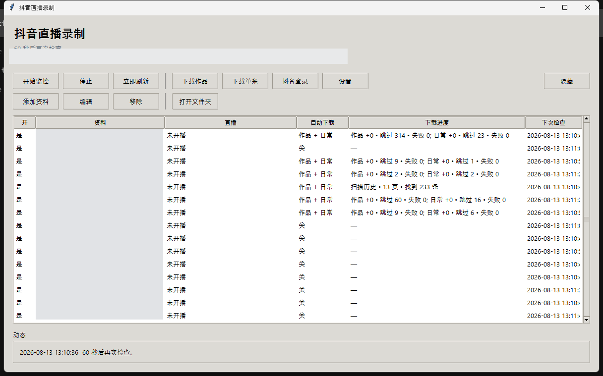

<p align="center">
  <a href="https://linux.do" title="LINUX DO">
    
  </a>
</p>

# 抖音直播录制

简体中文 | [English](#douyin-live-recorder)

本项目认可 [LINUX DO](https://linux.do) 社区。

Windows 便携版：录制抖音直播，并下载作品 / 日常。直播间探测走匿名请求（不带登录
Cookie），因此不会把你已经打开的抖音网页挤下线。

## 下载

到 [Releases](https://github.com/Ivan494/douyin-live-recorder/releases) 下载最新的
`DouyinLiveRecorder-vX.Y.Z-win64.zip`。解压到任意目录，运行
`DouyinLiveRecorder.exe`。已内置 Python 和 ffmpeg，不用再装别的。
只有使用 YouTube 直播资料时才需要另行配置 yt-dlp；抖音功能无需它。

默认**不会**开机自启。若需要，在设置里打开即可。
界面默认简体中文，可在设置里改成 English。

## 功能

- 直播录制成 MKV 分段，自动重连、卡顿检测
- 每个资料可单独关闭直播录制，只自动下载作品和日常
- 多账号并行，每个资料有独立的轮询间隔、清晰度和保存目录
- 作品和日常走移动端接口（X-Gorgon 签名）
- Live Photo 实况图同时保存照片和动态视频，补齐之前漏下的动态部分
- 纯 Python 签名（X-Bogus / Gorgon），盯直播不用开浏览器
- 可选抖音 App 登录（扫码后保存为 App 会话，本机 DPAPI 加密，不要提交到 git）
- 支持托盘的图形界面

## 演示效果



资料名称已打码。

## 从源码运行

需要：Windows、Python 3.11+，以及在 `PATH` 上的 `ffmpeg` / `ffprobe`
（或在 `src/settings.json` 里设置 `ffmpeg_path`）。

```text
pip install -r requirements.txt
python src/douyin_recorder_app.py
```

`src/DouyinLiveRecorder.exe` 是一个小启动器（没有捆绑运行时就会找 PATH 上的
`pythonw.exe` / `python.exe`）。

## 配置

| 文件 | 用途 |
| --- | --- |
| `src/profiles.json` | 监控的直播间 / 主页。默认是空列表。 |
| `src/settings.json` | 软件默认设置。开机自启默认关闭。 |
| `src/config.json` | 可选命令行值守脚本的模板。 |
| `src/douyin_session.json` | 本机加密登录态。已加入 .gitignore，不要提交。 |
| `src/mobile_session.json` | App 会话 Cookie。已加入 .gitignore，不要提交。 |
| `src/mobile_device.json` | 本机绑定的设备标识。已加入 .gitignore，不要提交。 |

路径占位符：

- `${DOWNLOAD_ROOT}` — `src/` 的上一级（可用 `--output-dir` 覆盖）
- `${TOOLS_DIR}` — 放 `ffmpeg.exe` 的目录

在界面里添加资料，或直接编辑 `src/profiles.json`。每个资料可单独设置输出目录、
轮询间隔、清晰度和是否自动下载。

朋友可见 / 互关可见的作品和日常需要当前登录账号有访问权限。
资料单独设置的 Cookie 优先；未设置时使用已保存的抖音 App / 网页登录。

### 日常

日常走移动端接口：优先 `/aweme/v1/story/profile/list/`，并回退到作品列表和
life/feed。需要已保存的抖音 App 登录（界面里的 **抖音 App 登录**）。
勾选 **自动下载日常**，或：

```text
python src/douyin_media_downloader.py --profile-url <用户主页> --stories --output-dir <目录>
```

近期日常超过首批 20 条时，程序会尝试扩大同一接口的获取数量（最多 320 条），
合并去重；如果服务端不再返回新内容，就停止扩大并提示分页停滞。
这不是已验证的独立分页接口，不能保证每个账号都能取完；历史列表仍只使用接口
明确返回的 `next_offset`，不会把时间戳猜成翻页游标。
扩大近期日常数量的请求失败或缺少必要元数据时，保留已取得的内容，并用上次
成功的请求数量继续历史列表；近期日常仍显示未完成，不会误报全部取完。

“下次继续扫描”表示本次达到页数上限且已保存翻页位置。
“分页停滞”“获取上限”或“接口请求失败”表示列表仍不完整，重复检查不保证补齐。
作品能下载不代表日常接口也可用；先确认同一登录账号能在 App 中看到目标日常。
诊断原因保存在输出目录的 `douyin_media_state.json` → `last_summary.stories.message`
（界面使用 `scan_reason` 显示简短分类）。反馈时只提供脱敏后的原因，不要上传整个
状态文件、Cookie、账号标识或带签名的媒体链接。

## 测试

```text
python -m pytest src/tests
```

## 打包 Windows 压缩包

```text
pip install -r requirements-release.txt
pwsh ./scripts/build_release.ps1 -Version 1.2.9 -FfmpegDir <含 ffmpeg.exe 和 ffprobe.exe 的目录>
```

推送 `v*` 标签会在 GitHub Actions 上走同样的打包流程。

发布流程使用独立的锁定依赖环境，验证源码与默认配置，只打包白名单文件，
解压到中文/空格路径后运行 EXE 自检。下载时可用 `SHA256SUMS.txt` 校验压缩包。
发布包不包含个人资料、登录态、设备标识、浏览器配置、日志或录制文件。
PR 会先验证完整构建；标签构建通过后才会公开发布。

## 声明

仅供个人存档。请遵守抖音用户协议，尊重创作者权利。与抖音 / 字节跳动无关。

## 许可证

[MIT](LICENSE)

---

# Douyin Live Recorder

[简体中文](#抖音直播录制) | English

Acknowledges [LINUX DO](https://linux.do).

Portable Windows app that records Douyin live streams and downloads posted
works / stories. Live-room probes stay anonymous (no login cookies) so
monitoring does not kick an already-open Douyin session.

## Download

Grab the latest `DouyinLiveRecorder-vX.Y.Z-win64.zip` from
[Releases](https://github.com/Ivan494/douyin-live-recorder/releases).
Unzip anywhere and run `DouyinLiveRecorder.exe`. Python and ffmpeg are
bundled; nothing else to install.
yt-dlp is only needed for YouTube live profiles and must be configured separately.

The app does **not** start with Windows unless you turn that on in Settings.
The interface defaults to Simplified Chinese; switch to English in Settings.

## Features

- Live recording to MKV segments with auto-reconnect and stall detection
- Optional per-profile live recording so works/stories can download without monitoring live streams
- Multiple profiles, each with its own interval, quality, and output folder
- Posted works and stories via the mobile API (X-Gorgon signed)
- Live Photos save both stills and motion clips, including clips missed by earlier downloads
- Pure-Python request signing (X-Bogus / Gorgon) — no browser required for
  live monitoring
- Optional Douyin app login (QR scan saved as an app-capable session; DPAPI-encrypted, local only)
- Tray-capable GUI

## Demo


Profile names are redacted.

## Run from source

Requirements: Windows, Python 3.11+, and `ffmpeg` / `ffprobe` on `PATH`
(or set `ffmpeg_path` in `src/settings.json`).

```text
pip install -r requirements.txt
python src/douyin_recorder_app.py
```

`src/DouyinLiveRecorder.exe` is a tiny launcher that starts the GUI (falls
back to `pythonw.exe` / `python.exe` on PATH when no bundled runtime is
present).

## Configuration

| File | Purpose |
| --- | --- |
| `src/profiles.json` | Monitored channels. Empty by default. |
| `src/settings.json` | App defaults. Autostart is off. |
| `src/config.json` | Template for the optional CLI watcher. |
| `src/douyin_session.json` | Local encrypted session. Gitignored. Do not commit. |
| `src/mobile_session.json` | App session cookies. Gitignored. Do not commit. |
| `src/mobile_device.json` | Bound device identity. Gitignored. Do not commit. |

Path tokens:

- `${DOWNLOAD_ROOT}` — parent of `src/` (override with `--output-dir`)
- `${TOOLS_DIR}` — folder that holds `ffmpeg.exe`

Add a profile in the GUI, or edit `src/profiles.json`. Each profile has its
own output directory, poll interval, quality, and download flags.

Friends-only works and stories require a login that can view them. A profile's
explicit Cookie takes priority; otherwise downloads use the saved app/web login.

### Stories

Stories use the mobile APIs, preferring `/aweme/v1/story/profile/list/` and
falling back to the post list and life/feed. That needs a saved Douyin app
login (GUI **Douyin App Login**). Enable **Auto-download stories** per
profile, or:

```text
python src/douyin_media_downloader.py --profile-url <user-url> --stories --output-dir <dir>
```

When the active bucket reports more than its first 20 stories, the downloader
tries a larger `active_data_size` on the same endpoint, up to 320, and merges
unique items. It stops expanding if the server returns no new items. This is
a bounded recovery attempt, not a verified separate active-page protocol or a
guarantee of full access for every account. Archive pagination still follows
only explicit `next_offset` values; timestamps are never guessed as offsets.
If an active-window retry fails or loses required metadata, available items
are retained and archive pagination continues with the last working request
size. The active scan remains incomplete rather than claiming full recovery.

“Continuing next check” means the request budget was reached and a continuation
was saved. A stalled list, active limit, or failed request remains incomplete;
another check does not guarantee recovery. Working post downloads do not prove
that the story API is available. Confirm the same login can see the stories in
the app. Local diagnostics are in the output folder's `douyin_media_state.json`
under `last_summary.stories.message`; `scan_reason` supplies the short UI label.
Share only the redacted reason, not the whole state file, cookies, account IDs,
or signed media links.

## Tests

```text
python -m pytest src/tests
```

## Build a Windows zip

```text
pip install -r requirements-release.txt
pwsh ./scripts/build_release.ps1 -Version 1.2.9 -FfmpegDir <folder-with-ffmpeg.exe>
```

Pushing a `v*` tag runs the same packaging on GitHub Actions.

## Disclaimer

For personal archival use only. Respect Douyin's terms of service and the
rights of content creators. Not affiliated with Douyin or ByteDance.

## License

[MIT](LICENSE)

## Maintaining a personal installation

See [the maintenance guide](docs/MAINTENANCE.md) for the source-first workflow, code-only deployment, checkpoints, and rollback.
